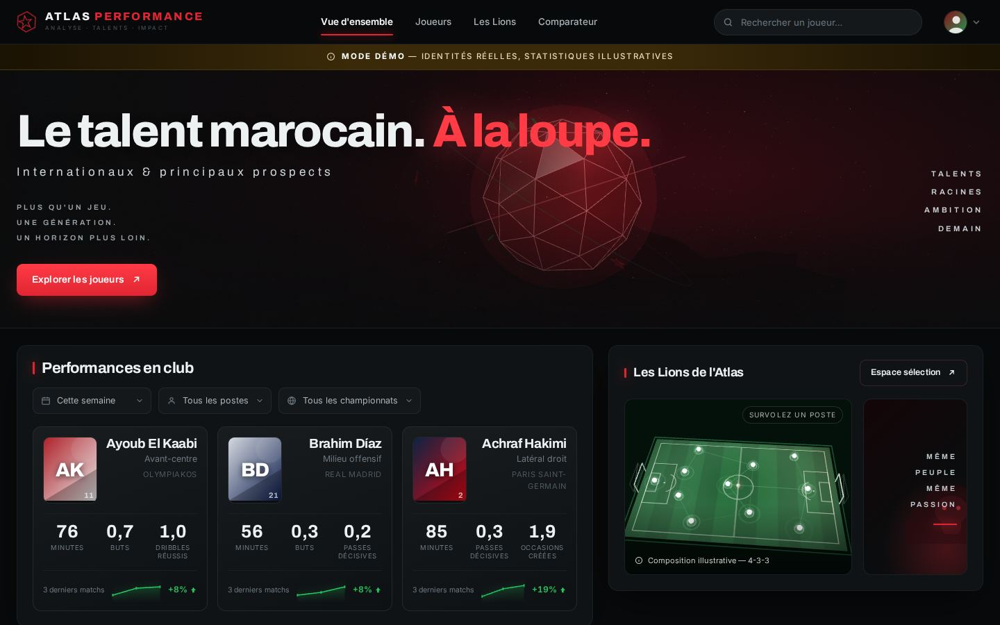
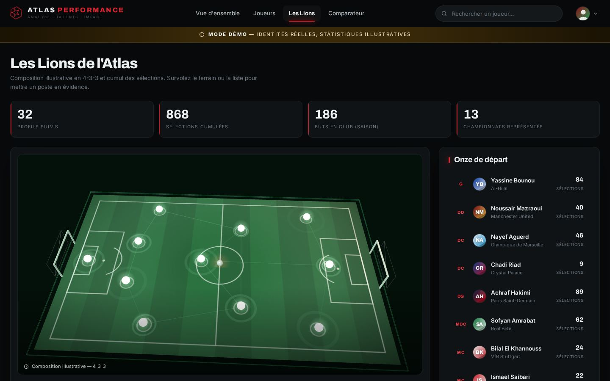
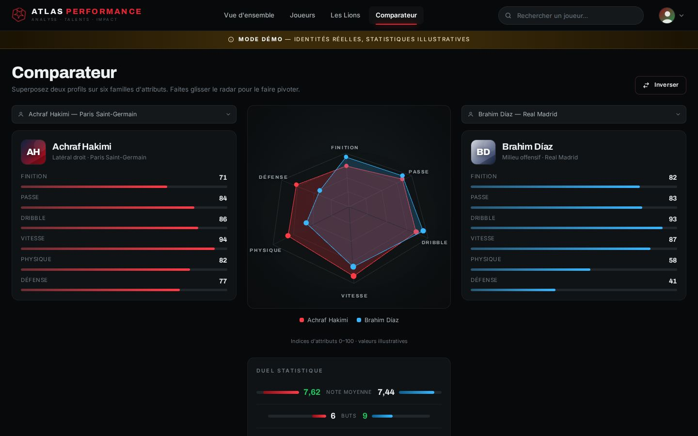

# Atlas Performance

**Le talent marocain. À la loupe.** — tableau de bord web des statistiques des
footballeurs marocains en activité, avec des scènes 3D animées (Three.js).

Site statique : aucune installation, aucun build, aucune dépendance réseau.



---

## Lancer le site

```bash
# depuis la racine du dépôt
python3 -m http.server 8000
# puis ouvrir http://localhost:8000
```

Un serveur est nécessaire (et non un simple `file://`) car l'application utilise
des modules ES et un `importmap`.

Pour une mise en ligne, n'importe quel hébergement statique convient
(GitHub Pages, Netlify, S3…) : il suffit de publier le dépôt tel quel.

---

## Ce que contient l'application

| Vue | Contenu |
|---|---|
| **Vue d'ensemble** | Héros 3D, cartes des joueurs les plus en forme, tableau « joueurs à suivre », terrain 3D de la sélection, bloc « la relève », bandeau comparateur |
| **Joueurs** | Grille filtrable (poste, championnat, statut) et triable (note, buts, passes décisives, minutes, progression, âge, nom) |
| **Les Lions** | Indicateurs cumulés, terrain 3D grand format et onze de départ synchronisé au survol |
| **Comparateur** | Radar 3D superposant deux profils sur six familles d'attributs + duel statistique chiffré |

| | |
|---|---|
|  |  |

Fonctions transverses : recherche instantanée (nom, club, poste, championnat),
fiche joueur en panneau latéral avec son propre radar, bascule
**par match / par 90 minutes**, fenêtre d'observation (3 derniers matchs,
5 derniers matchs, saison).

### Les trois scènes 3D

- `assets/js/three/hero.js` — ballon facetté en rotation, nervures lumineuses,
  anneaux d'orbite, étoiles marocaines extrudées, poussière additive, crêtes de
  l'Atlas générées procéduralement, parallaxe à la souris.
- `assets/js/three/pitch.js` — pelouse texturée au canvas (bandes, tracés,
  surfaces), marqueurs de joueurs pulsés, lignes de passe animées, caméra en
  balancement lent avec cadrage automatique, survol par lancer de rayon.
- `assets/js/three/radar.js` — toile hexagonale en perspective, deux polygones
  comparés dont les sommets s'animent au changement de joueur, rotation à la
  souris, libellés d'axes en surimpression HTML.

Les scènes hors écran sont mises en pause pour épargner le GPU, et
`prefers-reduced-motion` neutralise les animations CSS.

---

## Structure

```
index.html                    page unique (4 vues)
assets/css/style.css          thème sombre, grilles, composants, responsive
assets/js/data.js             ► LE JEU DE DONNÉES (à remplacer)
assets/js/app.js              rendu, filtres, tri, recherche, routage, fiche joueur
assets/js/three/hero.js       scène 3D du héros
assets/js/three/pitch.js      scène 3D du terrain
assets/js/three/radar.js      scène 3D du radar comparatif
assets/vendor/three.module.js Three.js r169 (MIT), embarqué pour un fonctionnement hors ligne
```

---

## ⚠️ À propos des données

**Les identités sont réelles, les statistiques ne le sont pas.**

`assets/js/data.js` recense 32 joueurs (24 internationaux, 8 prospects) avec
leur poste, leur club et leur rôle. En revanche **tous les chiffres — minutes,
buts, passes décisives, notes, indices d'attributs, tendances — sont
illustratifs** : le prototype n'est branché sur aucun fournisseur de données.
Le bandeau « Mode démo » et le pied de page le signalent dans l'interface.

Les affectations en club reflètent la saison 2025/26 au mieux de ce qui était
connu à la rédaction ; vérifiez-les avant toute réutilisation publique.

### Brancher de vraies données

**Chemin automatisé (recommandé).** Le dépôt contient une chaîne complète :
`scripts/fetch-stats.mjs` interroge API-Football et écrit un instantané dans
`assets/data/players.json`, que le site charge au démarrage et fusionne
par-dessus le jeu de démonstration. Un minuteur systemd le rafraîchit chaque
jour. Marche à suivre : **[`deploy/INSTALL.md`](deploy/INSTALL.md)**.

Ce que l'instantané remplace vraiment : club, championnat, matchs, minutes,
buts, passes décisives, note, pourcentage de passes, duels gagnés, passes clés,
dribbles, tacles, arrêts et buts encaissés. Ce qu'il ne remplace pas : les
**indices d'attributs du radar**, la **note de lecture du profil** et la
**forme sur cinq matchs** restent éditoriaux. Aucune offre gratuite ne fournit
les deux premiers, et la forme par match demanderait un appel par rencontre,
bien au-delà des 100 requêtes quotidiennes. Le bandeau du site le dit aux
visiteurs plutôt que de laisser croire que tout est mesuré.

**Chemin manuel.** Remplacez le tableau `PLAYERS` par la réponse de votre API
en conservant la forme des objets ; le reste de l'application suit sans autre
modification.

```js
{
  id: 'hakimi', name: 'Achraf Hakimi', pos: 'DEF',   // GK | DEF | MID | ATT
  role: 'Latéral droit', club: '…', league: '…',
  number: 2, age: 27, foot: 'Droit', height: 181,
  caps: 89, intlGoals: 12, tier: 'international',    // international | prospect
  s: { apps, min, goals, assists, rating, pass, duels, … },
  radar: { finition, passe, dribble, vitesse, physique, defense },  // 0–100
  form: [6.8, 7.1, 7.0, 7.9, 8.3],                   // 5 dernières notes
  trend: 12,                                          // progression en %
  note: 'Une phrase de lecture du profil.'
}
```

`FORMATION.slots` décrit la composition affichée sur le terrain (coordonnées
normalisées : `x` de 0 à 1 dans la longueur, `y` de 0 à 1 dans la largeur).

Aucune photo de joueur n'est utilisée : les avatars sont générés à la volée en
SVG à partir des initiales et des couleurs du club.

---

## Technique

Aucun framework, aucune étape de compilation. HTML, CSS et modules ES natifs,
plus Three.js r169 (licence MIT) embarqué dans `assets/vendor/`. Polices Archivo
et Inter servies par Google Fonts, avec repli système.

Testé sous Chromium (Playwright) de 412 px à 1536 px de large.

---

Prototype visuel · Données de démonstration · Aucune affiliation officielle avec
la FRMF, les clubs ou les joueurs cités.
